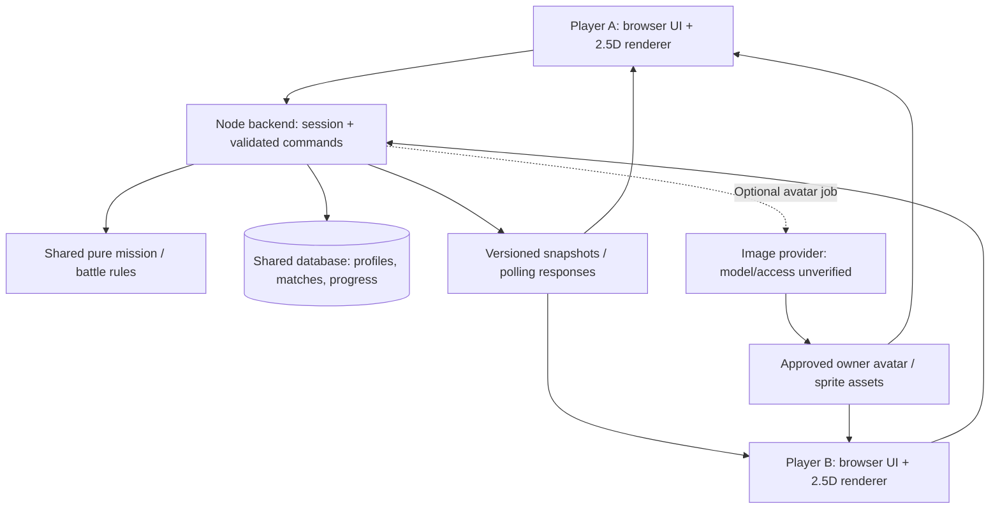

# Pokepet Go Architecture and Tech Spec

Source: https://chatgpt.com/space/page_98ac47d66d4c8191b83289c286f522bc

## Recommended stack

**Recommendation for team discussion:** Next.js + React + TypeScript, with Three.js for the 2.5D scene, Node.js Route Handlers for the backend, and MongoDB Atlas for shared state. Use HTTP and polling for the first two-player battle. This is a recommendation, not a confirmed team decision.

| Layer | Choice | Why |
| --- | --- | --- |
| Web app | Next.js, React, TypeScript | Component boundaries and shared types help two builders integrate UI and API in one repo. |
| Map and battle visuals | Three.js with animated sprites | Supports the requested tilted 2.5D view, camera and effects while using 2D character artwork. |
| Avatar generation | Image generation with the Hatch Pet sprite-sheet approach | Owner photo produces an owner avatar; sprites provide animated states. The exact ImageGen 2.5 model and access are unverified. |
| Backend | Node.js Route Handlers and separate game modules | Keep credentials, validation and authoritative battle rules server-side. |
| Database | MongoDB Atlas | Shared player and match state; aligns with the teammate's proposal, subject to available access. |
| Multiplayer | HTTP commands plus polling | A small first implementation for two-player turn-based battles; check whether latency is acceptable. |
| Testing | Focused game-rule tests plus real API/database and two-browser checks | Verify that both players see the same saved battle state, not just a single-client mock. |

**Decision condition:** Prefer this stack if the teammate knows Next.js or has working Next.js code. Otherwise compare migration time against extending the existing JavaScript/Node prototype. Preserve reusable game rules and tests; do not assume the existing prototype supports multiplayer.

**First integration checkpoint:** Two browsers join one match; a server-validated move updates the database; both show the same health and animation. Test a small Three.js scene with a preset sprite alongside it.

**Status · 1 November 2026.** Current user direction and a proposed implementation contract. This Page does not claim multiplayer, database, avatar generation or animation is implemented; it assigns no teammate ownership.

**Initial skeleton · 1 November 2026:** [codex/nextjs-skeleton](https://github.com/Alex0158/pokepets-go/tree/codex/nextjs-skeleton/web) contains a separate `web/` Next.js/React/TypeScript app, installed Three.js and MongoDB driver dependencies, and a Node health route. Production build, TypeScript check and HTTP home/health checks passed; the existing single-user prototype's six tests also passed. `main` is unchanged. No database connection, multiplayer, 2.5D rendering, avatar or AI integration is implemented. Preserve the local uncommitted prototype and agree integration ownership before merging.

## Confirmed user direction

- Real multiplayer battles need a shared backend and database; localStorage and a demo opponent do not meet that requirement.

- Upload the owner's photo and the pet's photo separately to generate distinct owner and pet characters; the live pipeline is not yet implemented.

- Mobile-first, Pokémon GO-inspired tilted 2.5D map showing owner, pet, missions and other players; pet sprite animation plus attack/hit effects.

- Use the Hatch Pet sprite-sheet approach; consider Codex Pets Web. Exact source, license and renderer compatibility remain unverified.

- One repo, small modular backbone, lightweight SDD/TDD, simple user flows and a working version first.

- ImageGen 2.5 is requested; the exact callable model/access is unverified. Astra, voice and Decisions roles remain proposals.

## Evidence and integration conflict

The inspected local `pokepets-go/docs/core-spec.md`, `package.json`, `server.mjs` and modules describe a **single-user native JavaScript prototype**: preset pet, SVG sample map, owner-confirmed missions, points, memories, upgrades and localStorage. `server.mjs` only serves static GET/HEAD requests; it is not a multiplayer API. The local handoff reports six tests and browser checks passed earlier; this Page update did not rerun them. No current remote, live backend, database or two-player acceptance was verified.

The teammate's [Initial Idea Draft](https://chatgpt.com/space/page_dea405f342fc81918daab7e603d81404) proposes Next.js/React/TypeScript and Atlas. The [earlier research](https://chatgpt.com/space/page_6ae73d6627c4819199c9f1b801afe501) recommends retaining the local prototype. Neither establishes a final shared stack or owner. Preserve reusable game rules and teammate work; agree integration ownership before implementation. The local spec remains accurate for its narrow prototype and needs a later scoped revision before implementing this multiplayer contract.

## Recommended stack — proposals, not team decisions

| Layer | Recommendation | Concrete reason | Key trade-off / dependency |
| --- | --- | --- | --- |
| Frontend runtime | Next.js App Router + React + TypeScript | Components and typed contracts support concurrent UI and API work in one repo | Migration and teammate familiarity need confirmation; preserve existing game rules |
| Backend runtime | Next.js Node Route Handlers with separate server modules | Keeps game validation, DB and AI credentials server-side in the same repo | Requires routes, session checks and tests; one repo does not mean one runtime |
| Alternative app shell | Existing native JavaScript UI and Node server | Avoids migrating the working prototype if team familiarity or time makes Next.js too costly | Backend routes and package/asset integration still require work; inspect teammate code before deciding. [Route Handlers](https://nextjs.org/docs/app/getting-started/route-handlers) |
| Map / rendering | Three.js tilted 2.5D scene with sprites; accessible DOM controls | Matches the requested tilted map while reusing 2D artwork; [Sprite](https://threejs.org/docs/pages/Sprite.html) is camera-facing | WebGL, camera/input, asset and resize work; static/list fallback. Renderer is recommended, visual direction is decided |
| Sprite pipeline | Hatch Pet-style sheet + frame manifest; evaluate Codex Pets Web behind one renderer interface | Separates reusable animation assets from game rules and owner identity | Exact source, license, sheet layout and web API are unverified; do not assume an embeddable runtime exists |
| Shared DB | MongoDB Atlas via server-side driver | Matches the teammate proposal; versioned match document can use conditional atomic updates | Access, cluster, schema and hosting are unverified. Multi-document reward settlement needs a transaction or a deliberate idempotent protocol. [Atomicity](https://www.mongodb.com/docs/manual/core/write-operations-atomicity/) |
| Multiplayer transport | HTTP commands + basic polling of versioned state | Small proposed first slice for a turn-based two-player battle; avoids an initial socket lifecycle | Added latency/request load; not suitable evidence of real-time movement. Poll interval and presence model remain open |
| Tests | Existing Node built-in test runner plus API/DB integration tests | Reuses `npm test` / `node --test` and pure-rule tests | Unit mocks cannot prove shared persistence or two-player sync. [Node test runner](https://nodejs.org/api/test.html) |
| AI adapters | Server-side owner-avatar generation, isolated optional adapters | Keeps provider work outside reward and match rules | ImageGen 2.5 access/model ID, latency and costs unverified; Astra/Decisions/voice are proposals, not dependencies of core play |

## Proposed runtime and module boundaries



Proposed repo modules: browser UI/map/renderer, server session/API, pure shared rules/contracts, persistence adapter, assets/avatar jobs, optional voice/Decisions/Astra adapters. Client animation displays accepted server events; it does not decide damage or rewards. Keep owner profile/avatar and pet identity/assets distinct.

## Essential interfaces — proposed contracts

| Interface | Minimum contract |
| --- | --- |
| Session / profile | Server-issued player identity; separate ownerAvatarAssetId and petId. Never trust a client-supplied player ID as authority |
| Owner avatar job | Validated owner-photo input → jobId/status → approved owner asset or explicit failure; cached/preset owner fallback is labelled. Photo consent, storage, retention and deletion rules must be decided before live uploads |
| Map snapshot | worldId, version, missions, owner/pet placements, other-player records and sample/live labels. Fictional coordinates first is a recommendation; GPS and sharing are unresolved |
| Match create / join | Match ID, two distinct participants, ready/state/version; reject non-members and invalid joins |
| Move command | matchId, expectedVersion, commandId, permitted move. Backend validates membership, turn and legality, computes outcome and conditionally persists once |
| State polling / reconnect | Read authoritative versioned snapshot; tolerate retry/out-of-order responses and reload. Presence/expiry and disconnect policy remain open |
| Mission completion / allocation | Confirmed action plus idempotency key; server validates once, saves reward/memory consistently and rejects insufficient balance |
| Sprite renderer | Asset manifest with frame rectangles, timing and idle/move/attack/hit states; accepts server event IDs; static fallback if sheet or renderer fails |

## Cross-module interface checklist

**Purpose:** enable parallel development with a small shared boundary. “Local” means present in the current uncommitted checkout, not integrated or hosted. Proposed shapes need agreement and real end-to-end testing.

| Boundary | Inputs → outputs | Status / responsibility | Failure or integration rule |
| --- | --- | --- | --- |
| Session → identity | `POST /api/session {displayName}` → session cookie + own player/pet; `GET /api/session` → own player, pet and matches | Local backend; server owns identity | Never trust a client-supplied player ID as session authority; expired/missing session is explicit |
| Player / pet → other modules | Opaque string `playerId`, `petId`; pet stats use `health, attack, defence, speed` | Local backend model; expose approved profile fields only | Legacy prototype uses `defense`: translate once at integration; do not silently treat spelling variants as identical |
| Map → match | Proposed map snapshot: `worldId, version, source, players[]`; player has `playerId, petId, position{x,z}` and approved asset references. `selectPlayer(playerId)` initiates an interaction | Proposed; isolated map uses fixtures, not live player presence | No raw photos or GPS unless separately agreed; a fixture is not evidence of another live player |
| Match create / join | `POST /api/matches {commandId,petId,opponentPlayerId}`; `POST /api/matches/:matchId/join {commandId,petId,expectedVersion}` → `{snapshot,receipt,duplicate}` | Local backend; creator invites a specific existing player | Server checks session, membership and version; retry same command ID and payload |
| Battle move / sync | `POST /api/matches/:matchId/moves {commandId,expectedVersion,move,targetPetId}`; `GET /api/matches/:matchId` → authoritative snapshot | Local backend supports `attack` and `defend`; HTTP plus DB was exercised locally | Client does not calculate the authoritative result; reject wrong player, illegal turn, conflicting retry or stale update |
| Match → animation | Accepted event `{id,matchId,commandId,version,actorPlayerId,move,targetPetId,resultingHp}` → renderer reacts | Local backend event and separate avatar-lab event filter; wiring not implemented | Deduplicate by match/command; hydrate reconnect without replay, ignore older versions; display latest HP even when polling skips effects |
| Mission → progression | `GET /api/progression`; `POST /api/progression/mission {commandId,missionId,confirmed}`; `POST /api/progression/upgrade {commandId,stat}` → saved snapshot and stable command receipt | Local MongoDB per-pet progression, authenticated ownership; real DB and HTTP verified | Server owns rewards; once per curated mission and 5-point upgrades are provisional demo rules. Duplicate command returns its original receipt plus latest snapshot; conflicting reuse fails. |
| Pet upgrade → battle | Saved `progressions.stats` → both activated participants' `stats`, full `hp`, and `progressionVersion` | Local transaction + real DB/two-session HTTP verified; UI wiring pending | Join re-snapshots both pets atomically and advances each progression version as a write fence. Concurrent upgrades serialize before or after activation; active matches and join retries never refresh stats. Requires transaction-capable local replica set at port 27030; standalone activation returns 503. |
| Owner / pet photos → avatar assets | Proposed: two separately identified photo jobs → status and approved owner/pet asset references or explicit failure | Research and isolated sample only; no live upload or image pipeline verified | Decide consent, access, retention and deletion; raw photos never enter map/battle snapshots; prior approved asset remains on failure |
| Sprite asset → renderer | Local manifest `{schemaVersion,sheet,width,height,animations}`, each state has `fps,loop,frames[{x,y,w,h}]` | Avatar-lab custom fixture format, not the official Codex sheet contract | Validate bounds and durations, provide fallback. Map adapter, asset URLs and separately held per-character animation state remain to integrate |
| Optional Decisions / Astra / voice | Proposed permitted context → bounded choice, text or audio | Not integrated; account/model access not verified here | Server validates any selected move; provider errors never corrupt match or reward state |

**Integration order:** (1) agree ownership and IDs, (2) connect two local browser sessions to the real match API, (3) adapt server `resultingHp` and both move types to the avatar renderer, (4) connect mission rewards only after server-side idempotent persistence and baseline stat mapping are designed, (5) add separate owner and pet photo jobs.

**Review challenges:** A command retry must return its original receipt even if the accompanying snapshot is newer; clients must not replay old effects after reconnect. A match document's atomic write does not automatically settle rewards in a separate player/pet document. Database unavailability must not fabricate a shared battle. Local-only MongoDB configuration and fixture visuals do not establish Atlas or production readiness.

## Map, pet animation and battle interface

**Proposed contract for parallel work.** The visual prototype may use explicitly labelled fixture data; live play uses server-approved snapshots and events. The map, renderer and battle service remain separate modules. See [Minimal Multiplayer Database Schema](https://chatgpt.com/space/page_da74cc1494e88191995af37ede1d5082).

**Updated avatar direction:** Upload the owner’s photo and the pet’s photo separately to generate distinct owner and pet characters; use the Hatch Pet sprite-sheet approach for animation. Generation, model access and renderer integration are not yet verified. Retain separate owner-avatar and pet-sprite asset references; do not expose raw photos in map snapshots. Photo storage, permissions and retention remain open.

```ts
// Opaque string IDs at the JSON boundary; BSON representation remains open.
type Id = string;
type Point = { x: number; z: number }; // fictional world units, not GPS

type MapPlayer = {
  playerId: Id;
  ownerAvatarAssetId?: Id; // owner and pet are separate
  petId: Id;
  petSpriteAssetId: Id;
  position: Point; // owner position; pet offset is visual-only
};

type MapSnapshot = {
  worldId: Id;
  version: number;
  source: 'fixture' | 'live';
  players: MapPlayer[];
};

type BattleEvent = {
  matchId: Id;
  commandId: Id; // matchId + commandId forms the stable event key
  version: number; // resulting match version
  actorPlayerId: Id;
  targetPetId: Id;
  move: 'attack' | 'defend'; // local backend
  resultingHp: number; // server-calculated
};

type BattleSnapshot = {
  matchId: Id;
  version: number;
  status: 'waiting' | 'active' | 'finished';
  participants: { playerId: Id; petId: Id; hp: number }[];
  turnPlayerId: Id | null;
  lastEvent?: BattleEvent;
};
```

**Flow:** map emits `selectPlayer(playerId)` → app requests or joins a match through the backend → server validates the session, turn and move and atomically saves the resulting match and event → client renders the authoritative snapshot and plays attack/hit for a newly accepted event. The camera, positions, shadows and sprite effects never decide damage or rewards.

**Renderer boundary:** `renderMap(snapshot)`, `selectPlayer(playerId)` callback and `playBattleEvent(event)`. Sprite assets use an agreed frame manifest with idle, move, attack and hurt; custom battle frames may need to be created. A static placeholder is permitted if an asset or renderer fails. Codex Pets Web's DOM renderer is only a candidate; Three.js integration has not been tested.

**Sync and privacy:** client ignores older match versions and deduplicates each `(matchId, commandId)`. On initial load or reconnect, apply the snapshot without replaying an old animation; then play only new accepted events. If polling skips events, render latest HP correctly; full animation history is not guaranteed. The server determines identity from the session and restricts match reads to participants. Map responses expose only approved public display fields and never raw owner photos or secrets.

**First integration checkpoint:** two real browser sessions join one match; one accepted attack is saved, both display the same resulting HP and each plays the effect once. Repeated polling or command retry does not apply damage again. Unit tests alone or fixture animation do not prove this checkpoint.

**Open:** session method; ID serialization; match join UX; world bounds, presence and GPS; sprite-sheet format/asset mapping; match retention and missed-event policy. These types are a proposal to review with both builders, not an implemented API.

Proposed persistence: separate player/owner profile, pet/progression, match snapshot with participants/version/turn/accepted command IDs, and asset/job metadata. Apply match updates with expected-version checks. Define bounded command history and settlement recovery before implementation; localStorage is only cache or an explicitly labelled solo fallback.

## Smallest working flow and verification gates

1. Agree stack/ownership and write the short interface spec before changing code; write a failing core test first.

2. Create/load two distinct player sessions with separate owner avatars and pets. Show both on the mobile map; label all fixture players and assets.

3. Create/join one shared match → accept legal moves through backend/DB → both clients observe the same outcome → reload and recover the same state. Manual commands and cached artwork may support this first working slice.

4. Add sprite idle/move/attack/hit states from accepted events; add owner-photo generation once access and photo handling are settled. Cached art does not prove live generation.

5. Test duplicate/retried moves, simultaneous or stale versions, non-member commands, invalid turns, insufficient points and exactly-once rewards. Exercise DB failure, polling timeout, reconnect and renderer/provider failure. Preserve saved progress; never fabricate a win while backend is unavailable.

6. Run the whole project unit suite, then API/real test-DB checks and a two-browser/two-session mobile flow. No multiplayer completion claim until both clients and persistence are demonstrated. A solo fallback must be labelled and cannot satisfy the multiplayer gate.

## Open decisions and next handoff

- Team integration owner and file ownership; whether working teammate Next.js code exists; retain native UI or integrate that shell.

- DB access/hosting, session/auth approach, match rules and turn/disconnect policy; polling interval and player presence.

- Map coordinate/world model, location consent/sharing, upload storage/retention; no GPS or public sharing approval inferred.

- Exact Hatch Pet / Codex Pets Web source and licenses, sprite-sheet manifest and animation ownership.

- Exact ImageGen 2.5 model/access; whether any proposed Astra, voice or Decisions integration is available or worth the demo time.

Use [Gameplay and Concept](https://chatgpt.com/space/page_6ae737e8939c819182db0903037dd8b5) for current experience direction and [Feature Modules and Checkpoints](https://chatgpt.com/space/page_6ae740255a908191b675c589a93bc207) for acceptance. This update changes shared documentation only; no code, provider request, deployment or submission.
