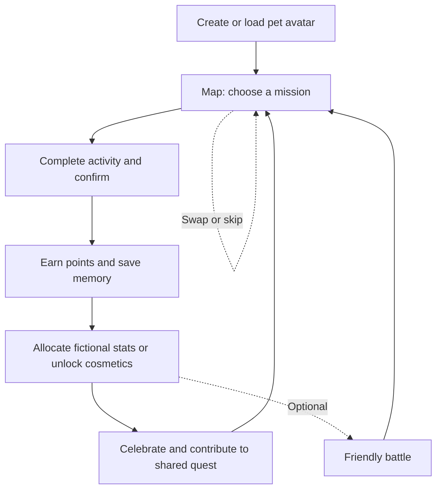
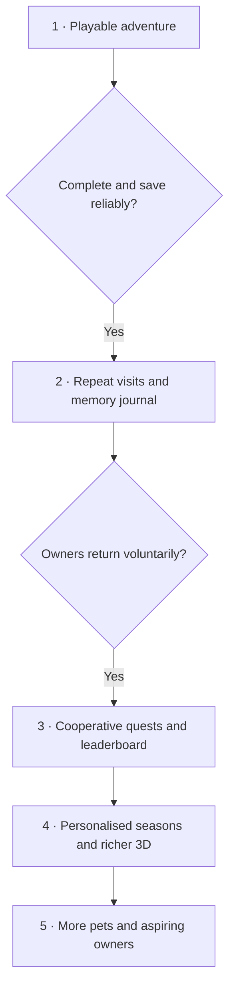
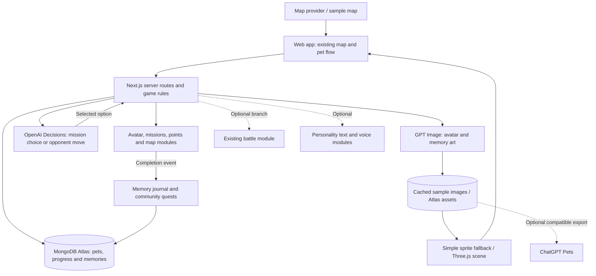

# Initial Idea Draft

Source: https://chatgpt.com/space/page_dea405f342fc81918daab7e603d81404

**Reconciliation · latest user direction, 1 November 2026.** This teammate draft and its distinct adventure/memory/community ideas are preserved. Current requirements: owner's photo → **owner avatar**, a separate pet character, mobile-first Pokémon GO-inspired tilted 2.5D map with owner/pet/missions/other players, real multiplayer battles with shared backend/database, and pet sprite animation with attack/hit effects. Use the Hatch Pet sprite-sheet approach; consider Codex Pets Web. ImageGen 2.5 is requested but exact model/access is unverified; Astra, voice and Decisions are proposals.

The historical plan below proposed a pet-photo flow, deferred multiplayer and suggested Next.js/React/TypeScript/Atlas and Builder A/B roles. Those are not current team decisions or ownership assignments. The inspected local code remains a single-user native-JavaScript/localStorage prototype; no multiplayer is established. Keep one repo, modular boundaries, lightweight SDD/TDD and working version first. See [Architecture and Tech Spec](https://chatgpt.com/space/page_98ac47d66d4c8191b83289c286f522bc) and [current checkpoints](https://chatgpt.com/space/page_6ae740255a908191b675c589a93bc207) for the active direction, proposed stack and unresolved integration choices.

# Earlier teammate vision — preserved

**Your pet is already the main character. Pokepet Go gives you a world to explore together.**

Pokepet Go turns everyday life with your pet into a shared adventure. Discover missions on a map, enjoy walks, playtime, or quiet bonding, and watch your personalised pet avatar grow. Each adventure becomes a collectible memory, with AI-created artwork and a playful animated companion bringing your story to life.

Meet nearby owners, work toward community goals, and enjoy friendly leaderboards. Even future pet owners can join through a demo companion. Our goal is simple: make caring for pets more fun, turn ordinary moments into memories, and build a community around the animals we love.

**Earlier editorial direction:** Adventures, memories and community lead, with battles optional and progression available without combat. Preserved from the earlier draft; the latest user request adds real multiplayer battles. Whether battles gate progression remains unresolved rather than inferred from this record.

# Four pillars

| Pillar | What it means | Example |
| - | - | - |
| Adventure | Turn ordinary routines into little discoveries | “Explore a new route and find this week’s forest spirit.” |
| Pet identity | Build a character that feels like your pet | Your shy terrier becomes a tiny wizard with a growing adventure journal. |
| Memories | Give real experiences lasting emotional value | Completing a quest creates a collectible card featuring your pet and a photo from the day. |
| Community | Help owners form connections through shared activities | Nearby owners contribute to a weekend quest to restore a virtual park. |

# Earlier synthesis of vision and gameplay

This earlier synthesis combined the adventure, memory, community and optional-battle ideas from [Gameplay and Concept](https://chatgpt.com/space/page_6ae737e8939c819182db0903037dd8b5). Its sample-map/demo-opponent plan is historical. Current user direction and [Architecture and Tech Spec](https://chatgpt.com/space/page_98ac47d66d4c8191b83289c286f522bc) supersede conflicting pet-photo, local-only and multiplayer-deferral assumptions. Reuse useful work; the documents alone do not establish implementation.

- **Adventure:** Extend the existing map and mission flow with varied destinations and curated activity choices.

- **Identity and growth:** Current onboarding uses an owner's photo to create the owner avatar; keep the pet as a separate character. Preserve the earlier ideas of fictional speed, defense, attack and health stats, personality, titles, accessories and celebrations.

- **Memories:** Build on the existing mission memory step with a saved journal and collectible artwork.

- **Community:** Extend community spots and friendly challenges with shared quests and capped leaderboards.

| Existing concept foundation | Combined direction |
| --- | --- |
| Avatar creation and simple animation | Reuse the avatar asset; add expressive companion states and an optional Three.js presentation. |
| Missions, points and allocation | Keep completion and stat rules; attach memories and cosmetic unlocks to the same completion event. |
| Map, routes and community spots | Add quest discovery and cooperative participation to the same map. |
| Decisions for opponent moves | Preserve this optional battle use; add curated mission selection as another use. |
| Astra for personalities, skills and dialogue | Retain this proposed text-generation role, subject to available model access. Use approved content and owner input. |
| Optional voice announcer | Keep the voice module optional; later explore adventure and celebration narration. |
| Small independent modules | Add memories and community at clear boundaries, preserving existing progress when optional services fail. |

# Earlier adventure-first experience — retained concept

**Create your pet → discover a mission → do it together → collect a memory and upgrade → contribute to a community challenge → return for another adventure.**

## Earlier player journey — historical diagram

The owner chooses the activity. Rewards follow confirmed completion; generated artwork can arrive afterward without blocking progress.

For example, an owner and pet complete a Sniff Safari, capture a favourite moment, receive a woodland adventure card, unlock a leaf cape, and contribute to the neighbourhood's weekly quest. A friendly battle is an optional activity after the adventure.

Mission variety should include outdoor exploration, at-home play, and quiet bonding. Progression should reward suitable, varied participation rather than pressure owners into ever-longer activities.

# Historical three-hour demo scope — earlier proposal

1. **Pet hero:** Select a sample photo and name; generate or display a cached avatar. Custom uploads are a stretch feature.

2. **Map and mission:** Show three curated choices on a sample map and complete one through owner confirmation.

3. **Memory and growth:** Award fixed XP and one upgrade, compose a memory card from existing artwork, and save progress to Atlas.

4. **Community preview:** Add a compact leaderboard after the core works, with real session progress and clearly labelled sample competitors. A cooperative meter is stretch scope.

5. **Optional battle:** Reuse a working demo encounter if available; spend no time building new combat within the three-hour limit.

The first demo should make completing a mission and receiving its memory feel rewarding enough to repeat. Live multiplayer, open chat, trading, a full social feed, and a large 3D world can follow later.

# Historical three-hour build plan and stack — earlier proposal

**Earlier planning assumption: two builders, three hours elapsed.** The plan below is retained for its useful breakdown, not as the current team's approved scope or schedule. Its pet-photo flow, multiplayer deferral, builder ownership and stack were proposals. Follow the current reconciliation above and the Architecture and Tech Spec for the requested multiplayer direction.

## Recommended stack

| Layer | Recommendation | Reason for this demo |
| --- | --- | --- |
| Web app and server | Next.js App Router, React and TypeScript; Node.js Route Handlers | One codebase for screens, database access and OpenAI calls. Keep an existing working framework if the team already has one. |
| Styling and state | Existing styling, or Tailwind from the scaffold; React state | Three compact views, shared TypeScript types, no new component system or state library. |
| Database | Existing free MongoDB Atlas, official mongodb Node.js driver | Persist pet progress and memories; support a small shared leaderboard without introducing another service. |
| Map | Clickable sample neighbourhood drawn with SVG or an existing map component | Three mission pins; no new map account, routing, live GPS or location permissions. Clearly label it as a sample map. |
| Pet presentation | Three.js sprite in one small client-side scene | Idle bob and completion bounce using the generated avatar. Keep the static image fallback; no model generation, rigging or 3D world. |
| AI | Server-side OpenAI calls: one Decisions choice and one GPT Image avatar generation | A visible purpose for both tools. Reuse the avatar in the memory card instead of generating another image on every completion. |
| Delivery | Existing team deployment target; local demo as backup | Check hosting and request limits early. Do not spend the final hour learning a deployment platform. |

Next.js supports custom server endpoints through [Route Handlers](https://nextjs.org/docs/app/getting-started/route-handlers), and MongoDB documents a [Next.js integration](https://www.mongodb.com/docs/drivers/node-frameworks/next-integration/). A [Three.js sprite](https://threejs.org/docs/pages/Sprite.html) displays a texture facing the camera, which suits a small animated avatar scene.

## Historical proposed session scope

**Must work:** select a sample pet photo and name → display or generate its avatar → select one of three curated missions on the sample map → confirm completion → earn fixed XP and one upgrade → save a memory card → reload and see the same progress.

- **Decisions:** recommend one eligible mission from the three choices using the owner's available time and indoor/outdoor preference. Allow manual choice. If a battle-based Decisions integration already works, reuse that demonstration before adding a second use.

- **GPT Image:** generate the avatar once, then cache and reuse it. Prepare a generated sample avatar in advance; clearly distinguish cached demo artwork from a live generation.

- **Memory:** compose a card from the avatar, mission title, date and owner caption. Custom photo upload and a fresh illustration for every memory are later improvements.

- **Three.js:** show the same avatar in a small scene with a reward animation. This is a 2D sprite presented in 3D, not a fully modelled pet.

- **Social demonstration:** add a small leaderboard after persistence works. Use the current pet's saved XP and clearly labelled sample competitors. A cooperative progress meter is the next stretch feature.

- **Existing battle:** preserve it if already working. Do not build or rewrite combat during this session.

**Earlier deferral proposal, now partly superseded:** This draft deferred live multiplayer, authentication, chat, GPS, custom 3D models, voice, extra personality calls, photo verification, seasons and ChatGPT Pets export. Real multiplayer with shared backend/DB is now requested; its identity/session design is unresolved. Voice and personality remain proposals. Codex Pets Web is being considered as a renderer and must not be conflated with a confirmed ChatGPT Pets export or sync integration.

## Historical minimal Atlas proposal — not a connected database

Use one private demo session per browser, issued by the server. Skip account registration for the controlled demo.

- **pets:** session ID, name, avatar reference, XP, allocated stats, completed mission IDs and a small embedded memory list.

- **assets:** generated avatar bytes in separate documents with MIME type; enforce a 1 MiB per-image demo cap. Bundle prepared sample images with the app. This avoids adding an upload service today; larger media storage comes later.

- Keep three mission definitions in code. Calculate the small demo leaderboard from pet XP instead of maintaining another scoring system.

Use one atomic conditional update to award XP, mark a mission complete and append its memory only if that mission is not already completed. Repeated clicks must not award points twice. Keep database credentials and OpenAI keys on the server and reuse the database connection.

If Atlas is not connected by minute 30, continue the UI against the agreed data shape while Builder B resolves access. If still blocked at integration time, use an explicitly labelled local-only demo fallback; do not imply that it has shared persistence.

## Earlier two-builder schedule — unassigned proposal

| Elapsed time | Builder A — experience | Builder B — data and integrations | Checkpoint |
| --- | --- | --- | --- |
| 0–15 min | Together: inspect existing work, freeze the demo flow and shared types | Together: verify Atlas and API access; agree on API response shapes | Scope and interfaces fixed |
| 15–60 min | Pet view, sample map and mission cards using fixture data | Atlas connection, session, load/save and duplicate-safe completion | First integrated completion at minute 60 |
| 60–105 min | Memory card, XP feedback and minimal Three.js animation | One Decisions use, cached GPT Image avatar, asset persistence | Complete journey works with saved progress |
| 105–120 min | Add compact leaderboard only if the core works | Integrate and resolve failures; verify cached fallbacks | Feature freeze at minute 120 |
| 120–150 min | Together: test the full flow, small screens and loading/error states | Together: fix persistence, duplicate rewards and integration issues | Reliable demonstration |
| 150–180 min | Together: rehearse a 60–90 second demo and record a backup | Together: verify delivery target and reset to a clean demo session | Ready to present |

**Earlier ownership proposal only:** agree shared types before separating UI and server/data work and integrate early. Builder A/B labels above do not assign any teammate or prove agreement. Current integration and file ownership must still be confirmed.

## Cut rules and demo acceptance

If behind schedule, cut the cooperative meter, extra avatar styles and leaderboard polish first. Use the prepared avatar if live generation is slow; retain manual mission choice when Decisions is unavailable. Keep all progress-saving and completion checks.

The demo is ready when a visitor can complete one mission, see an upgrade and memory, reload without losing them, and click completion again without gaining duplicate XP. Check that an AI failure still permits the journey. Explain which data is sampled and which actions are live.

# Earlier product roadmap — preserved proposals

The roadmap below preserves the earlier adventure/community strategy and longer-term ideas. Its three-hour plan does not control the latest requested multiplayer scope. These phases, measures and priorities are proposals, not team commitments or implementation status.

If a milestone is not met, improve that phase before expanding. Preserve an existing optional battle module throughout; extend it later only when useful.

## Phase 1 Prove the adventure loop

**Earlier Phase 1 goal:** prove the adventure and saved-reward loop. Current requested work also includes real multiplayer; see the current architecture spec and checkpoints.

Reuse the avatar, mission, points, map and memory rules where useful. The historical three-hour stack, builder split and cut rules remain proposals. Reconcile them with separate owner/pet identity, the requested tilted 2.5D map and shared multiplayer; preserve cached-artwork and failure fallbacks.

**Ready to move on when:** A new tester can complete the journey without guidance, keep their reward after reloading, and explain what they would like to do next.

## Phase 2 Make it worth returning

**Goal:** Turn the demo into a repeatable experience for a small owner pilot.

Add saved pet profiles, a curated mission library covering exploration, play, and quiet bonding, a memory journal, and cosmetic progression. Let owners choose or skip activities to suit their pet. Add real map discovery after settling the initial audience and location controls.

**Ready to move on when:** Pilot owners voluntarily return on another day, complete another mission, and revisit their memories. Track the first-session completion rate and return behaviour before setting numerical targets.

## Phase 3 Build local community

**Goal:** Give owners a reason to participate together.

Add opt-in neighbourhood groups, cooperative weekly quests, shared celebrations, and a weekly leaderboard based on capped mission participation. Include audience controls for shared memories and reporting and blocking before introducing interactions between strangers. Start with a small pilot area.

**Ready to move on when:** Multiple owners contribute to the same challenge, some return for the next one, and sharing and moderation controls work in the pilot.

## Phase 4 Deepen personal adventures

**Goal:** Make the experience feel increasingly like each pet's own story.

Introduce seasonal quest chains, richer character customisation, themed memory collections, and more expressive 3D pet interactions. Extend curated mission selection with owner preferences and recent activity if it proves useful. Let owners change the suggestion.

**Ready to move on when:** Players use the added variety and personalisation, while mission completion remains reliable and generation cost and waiting time stay within agreed budgets.

## Phase 5 Broaden participation

**Goal:** Welcome more pet types and people considering pet ownership.

Expand activity sets for additional pets, introduce a demo companion for aspiring owners, and explore organised community events. Extend the optional friendly battle module only if player interest and capacity justify it; progression remains available without combat.

**Ready to expand when:** Each new audience has suitable missions and a complete first-session experience, and the existing community experience remains manageable.

## Measures of progress

The proposed primary measure is **weekly returning owners who complete a mission and save a memory**. This captures repeat participation in the intended experience; it does not claim to measure pet health.

Supporting measures are first-mission completion, return on a later day, memory revisits, and repeat participation in cooperative quests. Monitor mission skips, failed reward saves, generation delays, and reports to identify friction. Set numerical targets after the first pilot establishes a baseline.

## Delivery priorities

Extend the shared modular foundation: avatar, missions and points, map, battle, and optional voice. Attach memories and community to the same completion and reward flow. Preserve working modules and existing progress. If time is limited, defer additional battle features, richer voice, open chat, trading, and a full social feed.

# Earlier feature and technology architecture — proposals

The following is the proposed implementation, not a claim that integrations are already built. **Three.js** is the working interpretation of “3D.js”; it is a separate JavaScript 3D library, not an OpenAI product. [Three.js](https://threejs.org/)

| Feature | Proposed tool role | What the application owns |
| --- | --- | --- |
| Owner avatar and separate pet identity | Current direction: owner's photo generates the owner avatar; the pet has separate assets. ImageGen 2.5 model/access remains unverified. | Separate owner/pet profiles, approved appearance and asset storage. |
| Mission selection | Decisions API chooses from eligible, curated mission IDs using preferences, time available and recent activities. | Eligibility rules, mission catalogue, swap and skip controls. |
| Map and discovery | Map provider supplies places and map data; Three.js can add character and quest effects. | Location consent, destinations and map interactions. |
| Mission completion | Owner confirmation first; optional later image classification can assist review. | Completion status, duplicate prevention and fixed reward rules. AI judgement is not proof an activity happened. |
| Memories | GPT Image creates a themed illustration using the saved moment and avatar reference. | Original photo, owner caption, date, journal and sharing settings. |
| Pet growth and animation | Three.js displays the companion, accessories and celebrations; generated sprites can be used in a 3D scene. | XP, unlocks and animation states. True 3D models need a separate modelling and rigging workflow. |
| Community and leaderboard | Reuse avatar and event artwork; themed scenery can celebrate collective progress. | Groups, contribution totals, capped scoring, ranking and moderation. |
| Aspiring owners | A preset companion and curated introductory missions reuse the same loop. | A clearly marked demo experience and separate demo progress. |
| Personality and dialogue | Retain the concept's proposed Astra text-generation role, subject to access. | Approved personality, skills and dialogue; deterministic gameplay rules. |
| Optional voice | Keep the proposed announcer module; later explore adventure narration. | Playback, captions, mute and text fallback. |
| Optional battles | Decisions API may select a permitted opponent move; Three.js presents the encounter. | Turn rules, outcomes and rewards. This is not required for progression. |
| Optional ChatGPT Pets extension | Prepare a compatible custom companion asset for use in ChatGPT. | Separate export or upload workflow; automatic game-state sync is unconfirmed. |

GPT Image supports image generation and editing. For this design, approve a reference avatar and reuse it for later artwork; the app still needs asset checks and animation code. [OpenAI image generation](https://developers.openai.com/api/docs/guides/image-generation)

## Earlier proposed runtime flow — historical diagram

**Earlier Decisions research / proposed role:** select a permitted opponent move or curated mission; actual API access and integration have not been verified here. The backend must validate choices and own state/rewards. This role is not a substitute for a human multiplayer opponent. [Earlier reference](https://developers.openai.com/api/docs/guides/decisions)

Run OpenAI calls on the backend. Save completion and rewards before generating memory artwork asynchronously. If generation fails, retain the original photo and offer a retry; if mission selection fails, show the eligible curated list.

## Companion experience and ChatGPT Pets

The **in-app pet** is a separate game character from the owner avatar. Current direction uses the Hatch Pet sprite-sheet approach for movement and attack/hit states; Three.js is a proposed presentation layer, and Codex Pets Web is a candidate requiring source/API/license verification. Generated artwork still needs animation code; it is not a rigged model or game runtime.

**ChatGPT Pets** are animated companions within ChatGPT. Treat a matching custom pet as an optional extension of the player's identity. The documented custom-pet workflow does not establish an embeddable game runtime or automatic synchronisation with Pokepet Go. [ChatGPT Pets documentation](https://learn.chatgpt.com/docs/pets)

**Current integration pointer:** The Atlas/Decisions/GPT Image/Three.js first-demo combination above was an earlier recommendation, not connected features or a final team decision. [Architecture and Tech Spec](https://chatgpt.com/space/page_98ac47d66d4c8191b83289c286f522bc) compares the native JavaScript prototype with the teammate Next.js/React/TypeScript/Atlas proposal and defines the shared-backend multiplayer gate. ImageGen 2.5 access is unverified; Astra, voice and Decisions remain proposals.

# Remaining scope decisions

- **Leaderboard:** For this demo, use fixed XP from distinct completed missions and labelled sample competitors. Final ranking and weekly cap rules remain a later decision.

- **Audience:** Decide whether to start with dog owners exploring outdoors or support indoor pets from the first release.

- **Aspiring owners:** Consider a demo companion so people without a pet can try the experience.

- **Location:** Use a sample map for the hackathon; decide on geolocation and opt-in location sharing before live nearby-owner discovery.
